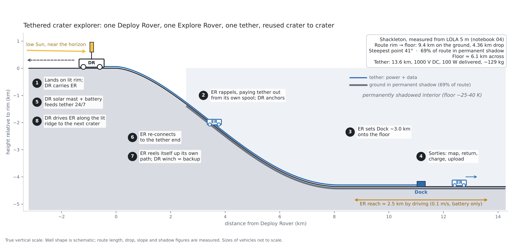

# Concept Sizing: Tethered Crater Explorer

First-order sizing of the Aggie Space Initiative concept for NASA RASC-AL 2027 Theme 1. A solar Deploy Rover (DR) anchors on a sunlit crater rim. An Explore Rover (ER) rappels down a power-and-data tether, sets a charging Dock on the floor, and maps the floor in battery-powered trips. When the crater is done, it reels itself back up and the DR carries it to the next crater.



| File | What it does |
| --- | --- |
| `sizing.py` | Sizes the tether, ER range, floor campaign, DR power, mass budget and rough cost. Prints a report and writes `results.json`. |
| `conops_fig.py` | Draws `figures/conops.png` from `results.json` (true vertical scale). |
| `results.json` | Output of the last `sizing.py` run. |

## Running it

```zsh
conda activate geoai
python sizing.py        # report + results.json
python conops_fig.py    # figures/conops.png
```

Only the standard library and matplotlib are needed.

`sizing.py` reads the measured Shackleton numbers from `../lunar-hazard-map/results/m4_summary.json` when notebook 04 has been run (the `design_inputs` block). These include route length, drop, steepest slope, shadow share, floor size, the tether run across the floor and floor coverage by driving distance. Without that file it uses built-in values from the November 2026 run and a straight-line estimate of coverage. The first line of the report says which one it used.

## What it calculates

**1. Tether.** The tether must carry power down to the Dock without wasting more than 10% of it. Sending the same power at higher voltage means less current, and the loss is current² × resistance, so the wires can be much thinner:

```
current I = P / V
allowed resistance (out and back) = 0.10 × P / I²
wire area = resistivity × 2 × length / allowed resistance
```

Resistivity is blended for the route: aluminium in permanent shadow (77–100 K) at 0.30× its room-temperature value, sunlit stretches at 1.22×. A Vectran braid carries the load, sized at 5× the worst pull. That's the ER plus a full spool on the steepest pitch, with tether mass and pull solved together. The report prints a 3 × 3 trade of voltage against power: at 100 W, 300 V needs ~610 kg of tether and 1000 V ~130 kg.

**2. ER range (the range equation).** On each trip the ER must drive out and back on one battery, with a reserve, even if the terrain is worse than planned:

```
r_max = E (1 − R) / (2 w (c + h / v))
```

- E is usable battery energy (2.4 kWh × 80%).
- R is the reserve (20%).
- w is the worst-case terrain factor (1.3).
- c is driving energy per metre (rolling resistance × weight ÷ efficiency).
- h is non-driving power (80 W: computer, lidar, lights, payload, heaters).
- v is speed.

At 0.10 m/s, h/v is about 94% of the energy per metre, so speed and heater power matter more than battery size.

**3. Floor campaign.** Transects 250 m apart over the floor in reach, half of each trip spent driving to and from the work. Each trip is ~14 h out and ~11 h charging, which gives sorties and days per crater.

**4. Deploy Rover.** Array output needed for the tether plus the DR's own loads, and a battery to keep the DR alive through a 5-day dark spell on the rim.

**5. Mass and cost.** Each line has a 15–30% growth allowance, plus 15% at system level. The rough cost adds development (analog placeholder), delivery at $0.6–0.9M per kg and two years of operations, then a 30% reserve.

## Numbers to replace

Every value in `ASSUME` at the top of `sizing.py` is a placeholder. The ones that move the answer most are:

- ER non-driving power (`er_hotel_w`)
- rolling resistance and drive efficiency
- the worst-case terrain factor
- aluminium resistance in the cold
- the dark-spell length at the chosen DR site

The development cost line must be replaced with a NASA cost-model estimate before the proposal.
