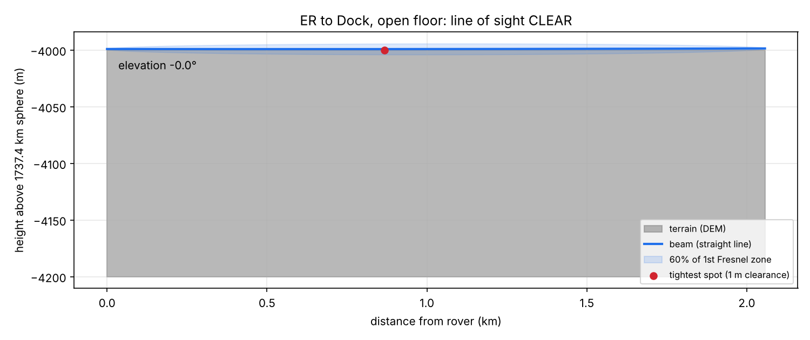
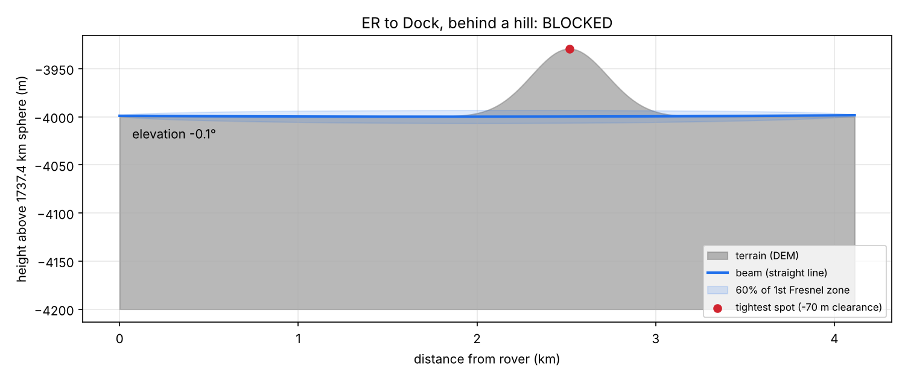

# Rover Comms: Antenna Angle and Line of Sight

Works out where the Explore Rover (ER) should point its antenna to reach its charging Dock on the crater floor, and whether the terrain in between blocks the signal. Part of the Aggie Space Initiative tethered crater explorer for NASA RASC-AL 2027 Theme 1.

In this design the ER's data goes Dock → tether → Deploy Rover on the rim, so the ER never needs to see the rim. The radio link that matters is ER ↔ Dock: when it is clear, the ER can report mid-trip; when it is blocked, the ER stores data and uploads at the next charge.

Two versions:

| File | What it is |
| --- | --- |
| `simple_comm_angle.py` | About 40 lines, built-in `math` only. Azimuth, elevation (with the Moon's curvature) and a yes/no line-of-sight check from a list of ground heights. Good for learning the method and quick hand checks. |
| `rover_comm_angle.py` | Full version. Reads LOLA GeoTIFFs directly, corrects for the rover being tipped on a slope (gimbal pan/tilt), checks radio Fresnel-zone clearance, and plots the terrain profile. |

Notebook `../lunar-hazard-map/04_shackleton.ipynb` (Section F) runs the same line-of-sight test from 1,500 points on Shackleton's floor to the chosen Dock site.

## The method (both versions)

1. **Distance** between rover and target: Pythagoras on the x and y differences.
2. **Azimuth** (which way to turn the antenna): `atan2(dx, dy)`.
3. **Elevation** (how far to tilt it up): `atan2(height difference - curve drop, distance)`, where `curve drop = distance² / (2 × 1737.4 km)`. The Moon curves away, so a target 2.5 km off sits about 1.8 m lower than it would on flat ground.
4. **Line of sight**: walk along the straight beam and check the ground (plus the curvature bulge) never rises above it.

## Running it

Simple version:

```zsh
python simple_comm_angle.py
```

Its example is an ER and a Dock 2.5 km apart with a 30 m bump halfway, so it prints BLOCKED. Flatten the bump in the `terrain` list to see it turn CLEAR.

Full version, synthetic demo (no data needed):

```zsh
conda activate geoai
python rover_comm_angle.py --demo
```

Full version on real LOLA data (south polar stereographic metres, same files as `lunar-hazard-map`):

```zsh
python rover_comm_angle.py --dem ~/lunar/data/ldem_87s_5mpp.tif \
    --rover X Y --target X Y --rover-mast 1.0 --target-mast 1.5 \
    --heading 45 --freq 2.4e9 --plot link.png
```

Only the area around the two points is read, so multi-GB GeoTIFFs are fine. The Dock's coordinates are in `../lunar-hazard-map/results/m4_summary.json` (`dock_xy_m`) after notebook 04 runs.

## Demo results (synthetic crater, illustrative only)

A Shackleton-sized bowl (21 km across, 4 km deep) with one 120 m hill on the floor:

| Link | Range | Azimuth | Elevation | Line of sight |
| --- | --- | --- | --- | --- |
| ER → Dock across open floor | 2.1 km | 171.9° | −0.02° | Clear by 0.9 m, but only 0.12 of the first Fresnel zone is clear, so expect extra signal loss |
| ER → Dock behind the hill | 4.1 km | 110.0° | −0.06° | Blocked by the hill (−70.5 m) |




Lesson from the demo: with antennas only 1–1.5 m up, even flat floor barely clears a 2 km link, because the Moon's curve lifts the ground in the middle. A taller Dock mast buys range cheaply.

## Checks done

- Map projection matches pyproj to about 1e-13°.
- Elevation over flat ground matches the curvature formula `−d / (2R)`.
- On a test slope of exactly 10°, the rover pitch and roll come out as 10°.
- Reading from a GeoTIFF gives the same answer as the in-memory demo.

## Placeholders to replace

Antenna heights (1.0 m ER, 1.5 m Dock), radio frequency (2.4 GHz) and ER wheelbase/track (0.6 m / 0.5 m) are guesses, not design values. Update them once the ER and Dock are sized.
