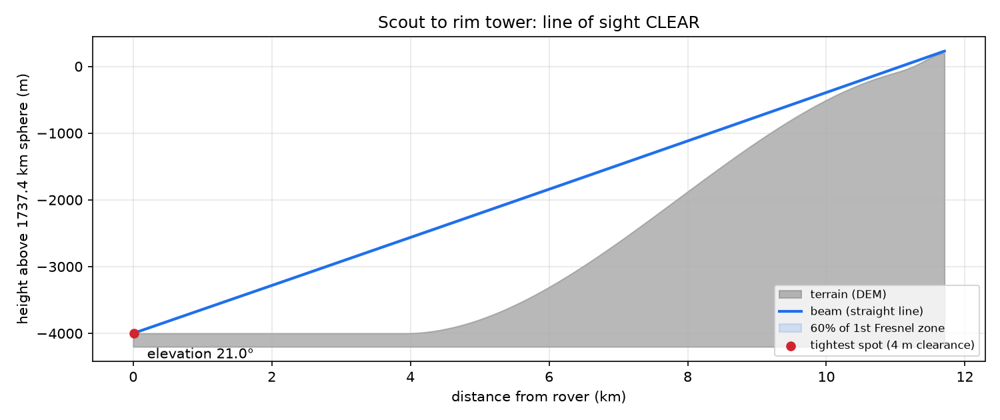
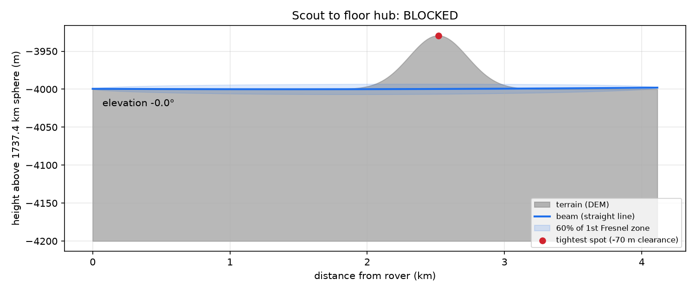

# Rover Comms: Antenna Angle and Line of Sight

Works out where a small scout rover should point its antenna to reach a hub, relay beacon or the rim tower, and whether the terrain in between blocks the signal. Part of the Lantern concept for the Aggie Space Initiative NASA RASC-AL 2027 Theme 1 proposal.

Two versions:

| File | What it is |
| --- | --- |
| `simple_comm_angle.py` | About 40 lines, built-in `math` only. Azimuth, elevation (with the Moon's curvature) and a yes/no line-of-sight check from a list of ground heights. Good for learning the method and quick hand checks. |
| `rover_comm_angle.py` | Full version. Reads LOLA GeoTIFFs directly, corrects for the rover being tipped on a slope (gimbal pan/tilt), checks radio Fresnel-zone clearance, plots the terrain profile, and checks a whole planned route to show where a relay beacon should be dropped. |

## The method (both versions)

1. **Distance** between rover and target: Pythagoras on the x and y differences.
2. **Azimuth** (which way to turn the antenna): `atan2(dx, dy)`.
3. **Elevation** (how far to tilt it up): `atan2(height difference - curve drop, distance)`, where `curve drop = distance² / (2 × 1737.4 km)`. The Moon curves away, so a target 10 km off sits about 29 m lower than it would on flat ground.
4. **Line of sight**: walk along the straight beam and check the ground (plus the curvature bulge) never rises above it.

## Running it

Simple version:

```zsh
python simple_comm_angle.py
```

Full version, synthetic demo (no data needed):

```zsh
conda activate geoai
python rover_comm_angle.py --demo
```

Full version on real LOLA data (south polar stereographic metres, same files as `lunar-hazard-map`):

```zsh
python rover_comm_angle.py --dem ~/lunar/data/LDEM_80S_20M.tif \
    --rover X Y --target X Y --rover-mast 0.5 --target-mast 30 \
    --heading 45 --freq 2.4e9 --plot link.png
```

Only the area around the two points is read, so multi-GB GeoTIFFs are fine.

## Demo results (synthetic crater, illustrative only)

A Shackleton-sized bowl (21 km across, 4 km deep) with one 120 m hill on the floor:

| Link | Range | Azimuth | Elevation | Line of sight |
| --- | --- | --- | --- | --- |
| Scout → rim tower (30 m mast) | 11.7 km | 11.2° | 21.0° | Clear |
| Scout → floor hub behind the hill | 4.1 km | 110.0° | −0.05° | Blocked by the hill |




Lesson from building the demo: a tower set about 100 m back from the rim crest lost sight of the crater floor, because the rounded upper wall hides it. Tower placement on the crest matters.

## Checks done

- Map projection matches pyproj to about 1e-13°.
- Elevation over flat ground matches the curvature formula `−d / (2R)`.
- On a test slope of exactly 10°, the rover pitch and roll come out as 10°.
- Reading from a GeoTIFF gives the same answer as the in-memory demo.

## Placeholders to replace

Mast heights (0.5 m rover, 30 m tower), radio frequency (2.4 GHz) and rover wheelbase/track (0.6 m / 0.5 m) are guesses, not design values. Update them once the scout and tower are sized.

RASC-AL 2027 requires disclosing AI use in the proposal. This code was written with an AI assistant; log it for the team's disclosure paragraph.
